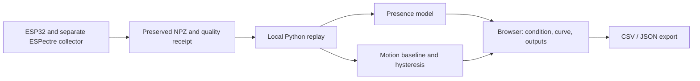

# WiFiPresence: brief technical design

**Public package:** new recordings, trained model files, trial inventories and device metadata are private and not included. Counts below describe the original local demonstration. Configure local inputs as described in README.md.

**2026-11-05 extension:** `live.html` and `wifipresence/presence_live.py` add explicitly started, bounded live CSI input using the separately installed pinned ESPectre environment. The loopback server exposes same-origin, JSON-only start/stop controls and displays cleanup/readback results. Streamed windows use the existing real-data model and project window-quality rule; they are not official whole-file admission. Simulated tests cover live lifecycle, faults and same-origin controls; actual ESP32 streaming and restoration remain unverified in this session. See `实时接入验证记录.md`.

Version 0.6, 2026-11-04. This describes the local demonstration and supplements the original research design.



The browser communicates only with the local Python service. The recorded replay uses existing inputs; the live stream is explicitly started on the live page, and acquisition of a saved labeled dataset is a separate entry. No LLM, remote API, database or account is needed. Python and NumPy were chosen because the existing model and team workflow already use them. A simpler alternative is a command-line-only replay, which is available in the original project but less convenient for an in-person demonstration.

## Data and implementation

`data/trials.json` identifies 26 selected real recordings, their recorded scene, chronological batch, split, SHA-256 and official receipt. NPZ original bytes are under `data/raw/`. `data/presence-model.json` contains frozen logistic parameters and training provenance; `data/motion-model.json` contains development-S1 calibration and hysteresis settings. The batch mapping and room labels are recorded human information, not machine-detected truth.

`app.py` offers a loopback-only trial list, replay and CSV/JSON downloads. It checks the trial ID, canonical quality receipt and raw-file hash before opening an NPZ without pickle. `wifipresence/core.py` implements windows, motion threshold and hysteresis; `presence_model.py` implements features, domain checks, score and UNKNOWN. Both motion methods use identical windows. UI code is `index.html`. The chosen interface only reads its bundled trial inventory and does not browse arbitrary files.

The implementation is designed to fail visibly for missing, altered or unverified files. A low-quality window produces UNKNOWN. Model output and the operator-entered scene are separate; the output is not a safety or control decision. Because the candidate is known to misclassify empty rooms, it must be described as an experimental research result. The live page reuses the separate pinned transport adapter described in the extension note above.

## Run and checks

On the existing computer, double-click `启动演示.cmd`, or run the following from this folder with the existing environment:

```powershell
python -X utf8 app.py
python -X utf8 -m unittest -v test_app
```

The first command opens the local demo; run the test command in another terminal. On 2026-11-04 the recorded-data checks passed, 26 included files replayed, and results on 18 validation/test files matched the prior report. On 2026-11-05 live simulation and browser checks were added; run `python -m unittest -v test_app test_live` for the current set. These are software and recorded-data observations, not proof of live hardware behavior. A fresh install on another machine has not been tested.

## Cost, deployment and open decisions

The application runs on the local PC and does not require a subscription. Existing hardware cost is not quantified. Before public upload, review raw-file device/network metadata, remove local-only paths and check authorization. The current presence model has substantial empty-room false positives; the proposed motion-interference improvement was not observed. Cross-room performance, response latency and a validated live detector remain open. Team review and instructor scope approval are unconfirmed.

## Handoff Context

- Current scope: explicitly started live stream, plus recorded-data selection, replay, motion comparison and export.
- Stack: Python 3, NumPy, browser, NPZ/JSON/CSV; ESPectre is separate.
- Safety boundary: unknown on inadequate input, labels distinct from predictions, no automatic control.
- Model status: small real-data experimental model; no reliable occupancy claim.
- Verification: local software tests, 26 recorded-file replays and browser checks.
- Remaining work: user/team understanding, instructor scope feedback, new independent evaluation after model changes.

```json
{"schemaVersion":1,"documentType":"techdesign","appName":"WiFiPresence","deployment":"local-loopback","language":"Python","dependency":"NumPy","liveInput":"bounded-pinned-espectre-adapter","verification":"simulated-live-and-local-recorded-data-checks; real-live-unverified-this-session","scopeApproval":"unconfirmed"}
```
